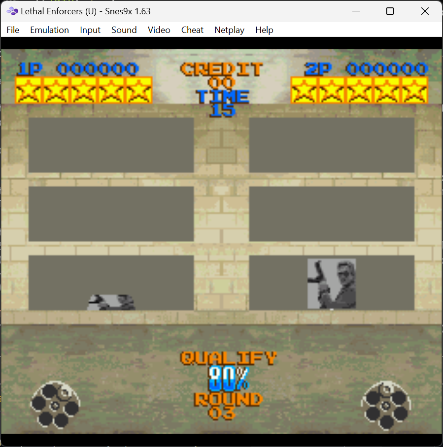

# retro-break

A [Claude Code](https://claude.com/claude-code) plugin that gives you something to do while Claude works.

When Claude has been working on a task for a minute, retro-break opens a **random SNES or GBA game** from your ROM folder. When Claude finishes, you get a **Windows notification**, so you can play until you reach a save point and then go back to work.

<p align="center"></p>

You only bring the ROMs. The emulators download themselves the first time they're needed:

| System | Emulator | File types |
| --- | --- | --- |
| SNES | [Snes9x](https://github.com/snes9xgit/snes9x) 1.63 | `.sfc`, `.smc` |
| GBA (and GB/GBC) | [mGBA](https://mgba.io) 0.10.5 | `.gba`, `.gb`, `.gbc` |

## Install

At the prompt of a Claude Code terminal session:

```
/plugin install retro-break --marketplace LaurentiuGabriel/retro-break
```

Answer `y` to add the marketplace, then pick a scope (user scope enables it in every session).

From a shell:

```
claude plugin install retro-break --marketplace LaurentiuGabriel/retro-break
```

In the desktop app, click **+** next to the prompt box, then **Plugins**, **Add marketplace** with `LaurentiuGabriel/retro-break`, then **Add plugin**.

## Set it up

The install asks for two settings. You can change them later in `/config`:

- **ROM folder**: where your ROMs are, e.g. `D:\Games\ROMs`. Subfolders are searched, so a folder per game works. To use several folders, separate them with `;`.
- **Seconds before a game opens**: 60 by default. Tasks shorter than this never open a game.

## How it works

- **You send a prompt:** a countdown starts.
- **Claude is still working when the countdown ends:** a random ROM opens in the right emulator, in a window 60% of the screen's height, centered. If a game is already open, it is left alone and no new one starts.
- **Claude finishes:** if the task ran past the countdown, a Windows notification says Claude is done. The game keeps running, so close it when you're ready.
- **Quick answers** and tasks you interrupt don't open a game or send a notification.

The emulators go into `%LOCALAPPDATA%\retro-break\emulators`. Save files and emulator settings are kept there too, so they survive plugin updates. To start fresh, delete that folder.

## What it runs, fetches and writes

Everything the plugin does outside Claude Code, listed in full:

| What | When | Details |
| --- | --- | --- |
| Lists your ROM folder | First game of a session | Reads file names only, up to 4 subfolders deep. Never reads, copies or uploads ROM contents. |
| `tasklist.exe` | Before opening a game | Checks whether `snes9x-x64.exe` or `mGBA.exe` is already running. |
| Downloads an emulator | The first time a game for that system is picked | `powershell.exe` downloads one pinned file over HTTPS from the emulator's official GitHub release ([Snes9x 1.63](https://github.com/snes9xgit/snes9x/releases/download/1.63/snes9x-1.63-win32-x64.zip), [mGBA 0.10.5](https://github.com/mgba-emu/mgba/releases/download/0.10.5/mGBA-0.10.5-win64.7z)) and unpacks it with Windows' built-in `tar.exe` into `%LOCALAPPDATA%\retro-break\emulators`. For mGBA it also writes an empty `portable.ini` there, so its settings stay in that folder. |
| Opens the game | When the countdown ends | `powershell.exe` runs `Start-Process` on the emulator with the chosen ROM, then resizes and centers its window through `user32.dll`. |
| Windows notification | When a long task finishes | `powershell.exe` shows a toast through the Windows notification API. If that fails, Claude Code's own notification is used. |

It sends nothing anywhere: no telemetry, no analytics. The only network traffic is the one-time emulator download from GitHub, and it never sends your prompts, code or files.

## Requirements

- Windows 10 or 11 (it uses PowerShell, `tar.exe` and Windows notifications).
- A recent Claude Code with plugin support.
- Your own ROM files. This plugin doesn't include or download any games.

## License

MIT for this plugin. Snes9x and mGBA have their own licenses and are downloaded from their official GitHub releases, not redistributed here.
